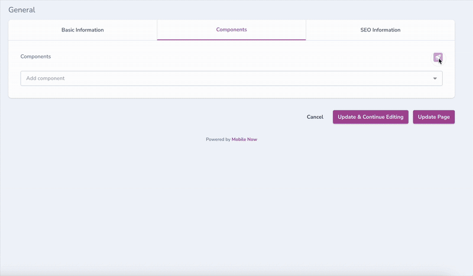
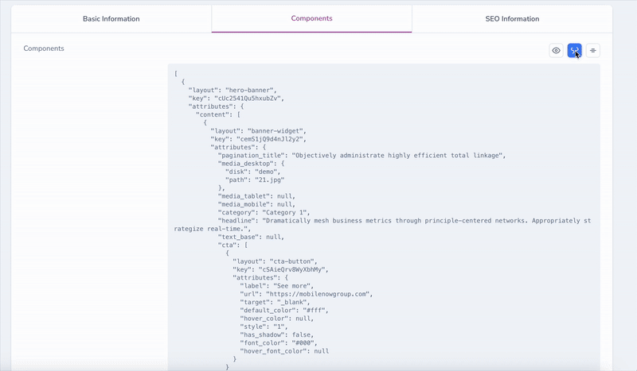
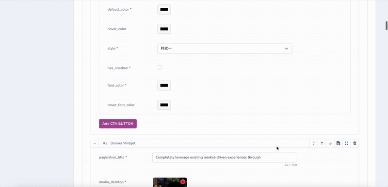
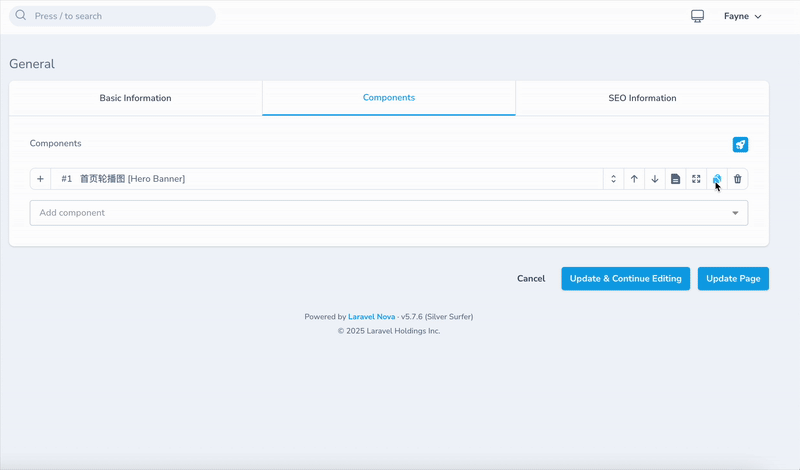

<p align="center"></p>

# Laravel Nova Page Builder

A powerful Laravel Nova 5 package for managing pages and building page components.









## Prerequisites

This package requires:

- PHP ^8.2
- Laravel 11.x
- Nova ^5.0

## Features (Client-Oriented)

- 🔄 **Dynamic Arrangement of Page Components**
- 👀 **Preview** - Requires custom frontend development
- 🔒 **Permission Control**
- 📈 **Flexible SEO Configuration**
- ⏰ **Scheduled Publishing**
- ⚡ **CDN + Static Deployment** - High performance
- 🔄 **Multiple Versions** - Easy rollback to previous versions

## Features (Developer-Oriented)

- 🚀 Most classes can be customized via the nova-page.php configuration file.
- 🔧 **Flexible Content** - Integrated with `whitecube/nova-flexible-content` for complex content blocks
- 🔒 Permissions can be overridden
- 🌍 **Multi-language Support** - Built-in i18n support with JSON translation files (English & Chinese)

## Multi-language Support

This package includes built-in multi-language support using JSON translation files. The following languages are available:

- **English** (`resources/lang/en.json`)
- **Chinese (Simplified)** (`resources/lang/zh_CN.json`)

### Overriding Translations

To customize translations, publish the language files to your application:

```bash
php artisan vendor:publish --tag=page-builder-lang
```

Or manually copy the JSON files from `vendor/fayne/laravel-nova-page-builder/resources/lang/` to your application's `resources/lang/vendor/laravel-nova-page-builder/` directory.

You can then modify the translations or add additional languages as needed.

## Installation

1. Install the package via Composer:

```bash
composer config repositories.fayne/laravel-nova-page-builder '{"type": "git", "url": "git@github.com:Fayne/laravel-nova-page-builder.git"}' --file composer.json

composer require fayne/laravel-nova-page-builder
```

2. Publish database migrations:

```bash
php artisan vendor:publish --provider="Fayne\\PageBuilder\\PageBuilderServiceProvider" --tag=migrations
```

3. Run migrations:

```bash
php artisan migrate
```

## How to use

```php
use Fayne\CMS\Contracts\ComponentInterface;
use Fayne\PageBuilder\FlexibleComponent;
use Fayne\PageBuilder\Layouts\Layout;

FlexibleComponent::make('Page Components')
    ->addComponents($components)
    ->enableDragPanel();
```

#### If you want to use this package independently, you can publish stubs into your project.

```shell
php artisan vendor:publish --tag=page-builder-sources
```

### Testing

```bash
# Run tests
composer test

# Run tests with coverage
composer test-coverage
```

## Contributing

1. Create a feature branch
2. Make changes
3. Add tests for new features
4. Ensure all tests pass
5. Submit a pull request

## License

This package is licensed under the [Proprietary License](../LICENSE.md).
